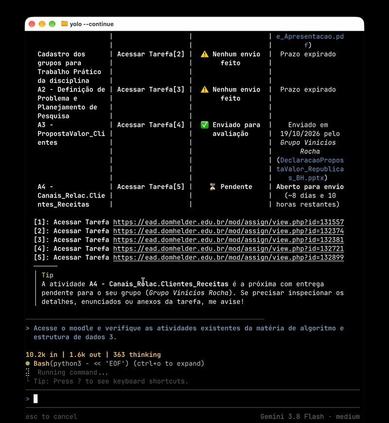
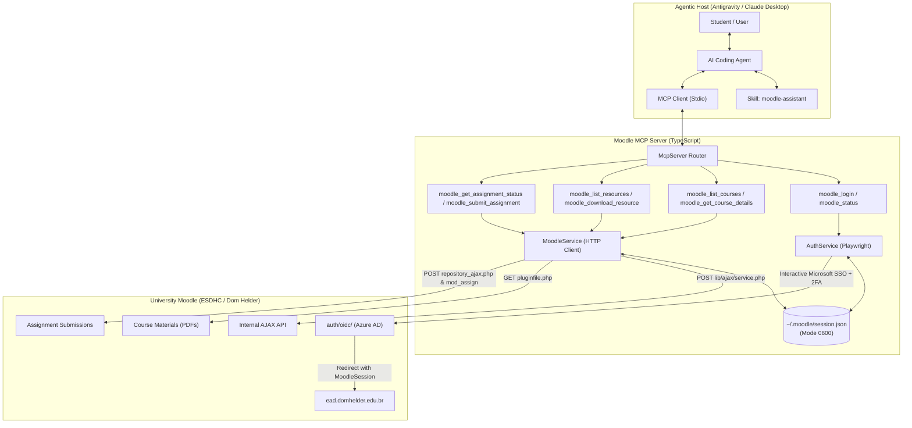

# Moodle MCP Server

> A production-grade **Model Context Protocol (MCP)** server for university Moodle LMS portals, featuring **interactive Microsoft Teams SSO (2FA)** authentication, internal AJAX service integration, and automated course material downloading.

[](https://www.typescriptlang.org/)
[](https://modelcontextprotocol.io/)
[](https://playwright.dev/)
[](LICENSE)

---

<p align="center">
  <a href="assets/preview.mp4">
    
  </a>
  <br>
  <em>Autonomous AI agent inspecting courses, materials, and assignment deadlines via Moodle MCP tools.</em>
</p>

---

## 📖 Overview

Interacting with enterprise/university Moodle portals often presents three major hurdles:
1. **SSO / 2FA Hurdles:** Institutional login via Microsoft 365 / Azure AD / Entra ID requires multi-factor authentication (Authenticator apps, SMS, CAPTCHAs), making purely headless scripted login prone to failure and security risks.
2. **Brittle HTML Scraping:** Themes, plugins (e.g., *Tiles format / format_tiles*), and custom CSS frequently break DOM-based scrapers.
3. **Protected Downloads:** Files are protected by session tokens and internal dispatchers (`pluginfile.php`), preventing simple public URL fetching.

**Moodle MCP** solves these problems cleanly:
* **Human-in-the-Loop Login:** Launches a visible, headful browser window (`moodle_login`) where you authenticate securely. Once logged in, it automatically captures the `MoodleSession` cookie and anti-CSRF `sesskey`, stores them in a secure local vault (`~/.moodle/session.json` with `0600` permissions), and closes the window.
* **Native AJAX Dispatcher:** Bypasses CSS selectors by directly consuming Moodle's internal JSON dispatchers (`lib/ajax/service.php`), delivering structured course data reliably.
* **Direct File Streaming:** Replicates Moodle's native resource downloads (`/mod/resource/view.php`), following redirects and preserving original instructor filenames.

---

## 🏛️ Architecture



---

## 🗂️ Project Structure

The project is structured according to strict domain-driven TypeScript principles:

```
moodle-mcp/
├── assets/
│   ├── preview.gif            # Demo animation for README
│   └── preview.mp4            # Demonstration video
├── src/
│   ├── types/
│   │   ├── session.ts         # User profiles, session data, and status interfaces
│   │   ├── course.ts          # Course summaries, sections, modules, and download results
│   │   └── assignment.ts      # Assignment details, submission options, and results
│   ├── config/
│   │   └── constants.ts       # URLs, timeouts, polling intervals, and path constants
│   ├── storage/
│   │   └── sessionStore.ts    # Secure file-based session vault (~/.moodle/session.json)
│   ├── services/
│   │   ├── authService.ts     # Playwright interactive SSO authentication runner
│   │   └── moodleService.ts   # Core HTTP client consuming Moodle internal AJAX endpoints
│   ├── tools/
│   │   ├── authTools.ts       # moodle_login, moodle_status tool definitions
│   │   ├── courseTools.ts     # moodle_list_courses, moodle_get_course_details
│   │   ├── resourceTools.ts   # moodle_list_resources, moodle_download_resource
│   │   └── assignmentTools.ts # moodle_get_assignment_status, moodle_submit_assignment
│   └── index.ts               # MCP Server setup, tool registration, Stdio runner
├── dist/                      # Compiled JavaScript distribution
├── test/
│   └── integration.test.ts    # Full end-to-end integration test suite
├── tsconfig.json              # Modern TypeScript configuration
└── package.json               # Package manifests and build scripts
```

---

## 🛠️ MCP Tools Reference

### 1. `moodle_login`
Opens a visible Chromium browser window directly at the institutional SSO login endpoint (`/auth/oidc/`). The tool waits for the user to complete their login and 2FA. Once Moodle redirects to the dashboard, it captures the session cookies, saves them to disk, and closes the browser.
* **Arguments:**
  * `timeoutSeconds` *(number, optional, default: 180)*: Maximum time to wait for the user to authenticate.

### 2. `moodle_status`
Checks if the currently stored Moodle session is active and valid.
* **Arguments:** None
* **Sample Output:**
  ```json
  {
    "authenticated": true,
    "user": {
      "name": "CARLOS HENRIQUE DE JESUS CARNEIRO ORLANDI",
      "id": "13341"
    },
    "sesskey": "MfAittHaxc",
    "updatedAt": "2026-10-21T13:41:10.826Z"
  }
  ```

### 3. `moodle_list_courses`
Fetches all enrolled courses for the student, including course IDs, full names, shifts/schedules, and completion progress.
* **Arguments:**
  * `classification` *(string enum, optional, default: `'all'`)*: Filter courses by `'all'`, `'inprogress'`, `'past'`, or `'future'`.

### 4. `moodle_get_course_details`
Returns the full hierarchical breakdown of a specific course, including sections/tiles, lectures, assignments, and quizzes.
* **Arguments:**
  * `courseId` *(number, required)*: The numeric course ID (e.g. `6708`).

### 5. `moodle_list_resources`
Filters and returns only downloadable course resources (PDFs, slides, syllabi, exercises) for a course.
* **Arguments:**
  * `courseId` *(number, required)*: The numeric course ID.

### 6. `moodle_download_resource`
Downloads a resource file directly to a specified directory on the local filesystem, automatically resolving the teacher's original filename via HTTP headers and redirects.
* **Arguments:**
  * `cmid` *(number, required)*: The numeric module ID of the resource (e.g. `129631`).
  * `targetDir` *(string, required)*: Target directory on disk (e.g. `"/Users/carlos/Downloads"`).
  * `customFilename` *(string, optional)*: Custom name for the saved file.

### 7. `moodle_get_assignment_status`
Inspects the full status of a homework assignment or exercise: title, submission status (e.g., "Enviado para avaliação", "Nenhum envio foi feito ainda"), due date, time remaining, grading status, submitted files, and edit permissions.
* **Arguments:**
  * `cmid` *(number, required)*: The numeric course module ID of the assignment (e.g. `132724`).
* **Sample Output:**
  ```json
  {
    "cmid": 132724,
    "title": "Entregar - Lista Árvores Trie, B, B+ e Patricia - revisão prova A2",
    "submissionStatus": "Nenhum envio foi feito ainda",
    "gradingStatus": "Não há notas",
    "dueDate": "23 de outubro de 2026, 23:59",
    "timeRemaining": "2 dias 12 horas restando",
    "lastModified": null,
    "submittedFiles": [],
    "onlineText": null,
    "canEdit": true,
    "canSubmit": false,
    "moodleUrl": "https://ead.domhelder.edu.br/mod/assign/view.php?id=132724"
  }
  ```

### 8. `moodle_submit_assignment`
Submits an assignment or exercise directly using native HTTP multipart upload and Moodle's `repository_ajax.php` dispatcher. Supports uploading a solution file (PDF, code, zip, etc.) and/or submitting online text. Can save submission as draft or permanently confirm/lock the submission.
* **Arguments:**
  * `cmid` *(number, required)*: Course module ID of the assignment.
  * `filePath` *(string, optional)*: Absolute filesystem path to the solution file to upload.
  * `onlineText` *(string, optional)*: Text or code to submit for assignments accepting online text.
  * `confirmFinalSubmission` *(boolean, optional, default: `false`)*: Whether to finalize and lock the submission (if instructor enabled submission confirmation).
* **Sample Output:**
  ```json
  {
    "success": true,
    "cmid": 132724,
    "title": "Entregar - Lista Árvores Trie, B, B+ e Patricia - revisão prova A2",
    "message": "Assignment successfully saved with status: \"Enviado para avaliação\"",
    "submissionStatus": "Enviado para avaliação",
    "gradingStatus": "Não há notas",
    "uploadedFiles": [
      "AEDIII_Lista_Arvores.pdf"
    ],
    "onlineTextSubmitted": false,
    "lastModified": "quarta-feira, 21 out. 2026, 11:50",
    "timestamp": "2026-10-21T14:50:00.000Z"
  }
  ```

---

## 🚀 Getting Started

### Prerequisites
* **Node.js** v18+ (tested on Node.js v24)
* **npm** v9+

### 1. Install Dependencies
```bash
git clone <repository_url> moodle-mcp
cd moodle-mcp
npm install
```

### 2. Build TypeScript
```bash
npm run build
```
This compiles all TypeScript files into `dist/`.

### 3. Run Integration Tests
```bash
npm test
```
The test suite validates session discovery, course querying, section hierarchy parsing, and actual PDF file downloading to `/tmp/`.

---

## ⚙️ Configuration

### Global MCP Configuration (`mcp_config.json`)
To enable this server in **Google Antigravity** or **Claude Desktop**, add it to your configuration file:

**macOS Location:** `~/.gemini/config/mcp_config.json` (or `~/Library/Application Support/Claude/claude_desktop_config.json`)

```json
{
  "mcpServers": {
    "moodle": {
      "command": "node",
      "args": [
        "/Users/carlos/Documents/Projects/moodle-mcp/dist/index.js"
      ]
    }
  }
}
```

---

## 🧠 Antigravity Skill Integration

A companion skill is configured at `~/.gemini/config/skills/moodle-assistant/SKILL.md`. This skill equips the agent with domain-specific runbooks:

1. **Self-Healing Session Flow:** When you ask to inspect a course or download materials, the agent checks `moodle_status`. If the session is absent or expired, it automatically invites you to authenticate via `moodle_login`.
2. **Organized Downloads:** The agent inspects syllabi, matches modules, and arranges downloads into cleanly structured local folders (e.g., `~/Downloads/Moodle/<CourseName>/`).

---

## 🔒 Security & Privacy

* **Zero Credential Storage:** Institutional passwords and 2FA tokens are **never** stored or seen by the AI agent. Authentication happens inside a genuine, isolated Chromium browser instance.
* **Restricted File Permissions:** Stored session tokens in `~/.moodle/session.json` are written with mode `0600` (read/write only by the current OS user).
* **Direct Server Communication:** All communication happens directly between your local machine and your university's official Moodle domain (`ead.domhelder.edu.br`). No third-party relays are involved.

---

## 📄 License
MIT © 2026 Carlos Henrique
